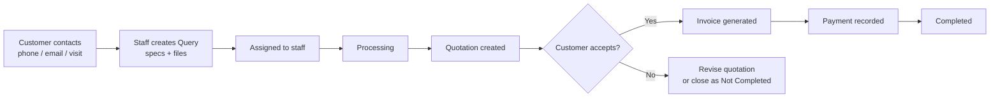
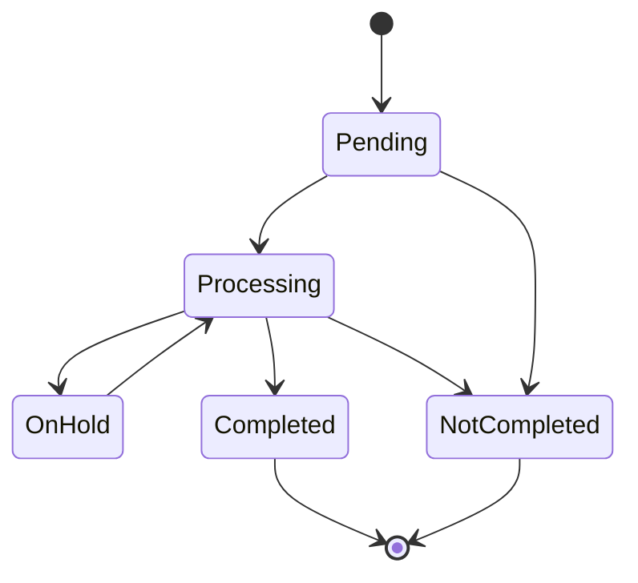
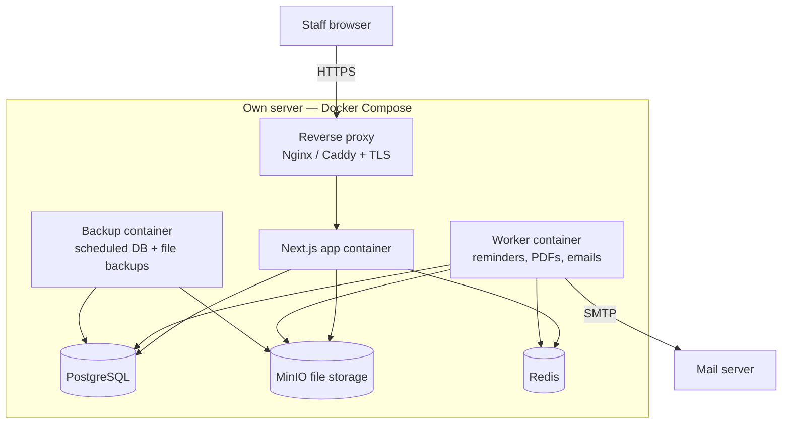
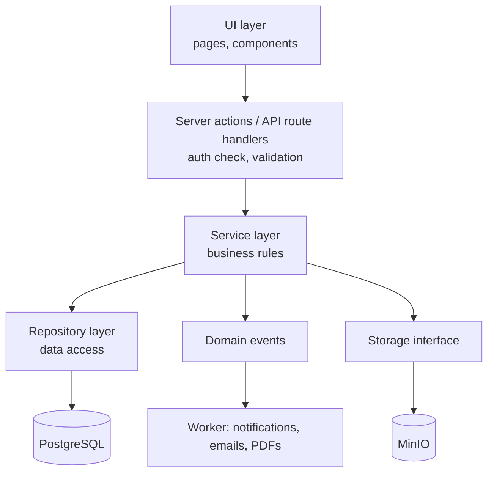

# Query & Order Management System — Project Scope

**Version:** 0.1 (Draft) · **Date:** 23 Oct 2026
**Type:** Internal web application · **Stack:** Next.js · PostgreSQL · Docker (self-hosted)

---

## 1. Overview

An internal tool for staff to record customer queries/orders received through outside channels (phone, email, WhatsApp, walk-in), track their processing, create quotations, and generate invoices. Management gets an admin dashboard for operations and reporting.

Customers do **not** log in. All data is entered and managed by internal users.

### Objectives
- One place to record every customer query with its specifications and files
- Clear ownership: who is working on what
- Status tracking with automatic turnaround time
- Quotations with price, tax and due dates, and invoices generated from them
- Reminders so nothing is missed
- A dashboard and reports for management

---

## 2. Users & Roles

| Role | Can do |
|---|---|
| **Super Admin** | Everything, including user management, system settings (tax rates, number formats, company details) |
| **Manager** | View all queries, assign/reassign work, approve quotations, view all reports |
| **Staff** | Create queries, update status of assigned work, upload files, draft quotations, generate invoices (if permitted) |

Permissions are role-based (RBAC) and defined in one place, so new roles can be added without changing feature code.

---

## 3. In-Scope Features

### 3.1 Authentication & Users
- Email + password login (hashed passwords), session management
- Create, deactivate and edit users; assign roles
- Password reset by admin
- Login activity log

### 3.2 Customers
- Create, edit and search customers (name, company, phone, email, address, NTN/tax no., notes)
- View a customer's full history of queries, quotations and invoices
- Duplicate warning on matching phone/email

### 3.3 Queries / Orders (core module)
- Auto-generated reference number (e.g. `QRY-2026-0001`)
- Fields: customer, source channel, title, product/category, specifications (rich text), quantity, priority, required-by date
- File attachments (multiple; PDF, images, Office files, CAD) with size/type limits
- Assign to a staff member; reassign with history
- Status lifecycle (see Section 5) with a mandatory reason for "Not Completed"
- Internal comments/notes timeline
- Full activity history: who changed what and when
- Turnaround time calculated automatically from status history
- List view: search, filters (status, assignee, customer, date, priority), sorting, pagination, saved filters, export to Excel/CSV

### 3.4 Quotations
- Created from a query; one query can have multiple quotation versions (v1, v2…)
- Line items: description, quantity, unit price
- Tax: configurable rate(s) (e.g. GST %), auto-calculated tax and total
- Optional discount
- Validity/due date and submission date
- Status: Draft → Sent → Accepted / Rejected / Expired
- Terms & conditions (default text, editable per quotation)
- PDF generation with company branding

### 3.5 Invoices
- Generated from an accepted quotation in one click (values copied, still editable before issuing)
- Auto invoice number (e.g. `INV-2026-0001`), sequential and never reused
- Issue date and payment due date
- Payment status: Unpaid → Partially Paid → Paid; Overdue automatic; Cancelled with reason
- Record payments (date, amount, method, reference)
- PDF generation
- An issued invoice is locked; corrections are made by cancelling and reissuing (audit-safe)

### 3.6 Reminders & Notifications (internal)
- In-app notification centre for staff and managers
- Optional email notifications
- Automatic reminders for:
  - Queries pending or processing longer than a configurable number of days
  - Quotations approaching their due/validity date
  - Invoices approaching or past their payment due date
  - Newly assigned work
- Daily background job runs the checks

### 3.7 Admin Dashboard & Reports
- **Overview cards:** Pending, Processing, Completed, Not Completed, Overdue
- **Workload:** open items per staff member, average completion time per staff member
- **Pipeline:** queries → quotations → accepted → invoiced (conversion rates)
- **Finance:** quoted value, invoiced value, received, outstanding (by period)
- **Trends:** queries per month, completion time trend
- **Lists:** overdue queries, expiring quotations, unpaid invoices
- Filters by date range, staff, status and customer
- Export reports to Excel and PDF

### 3.8 Settings
- Company profile (name, logo, address, tax no.) used on PDFs
- Tax rates, currency (default PKR), number formats/prefixes
- Reminder thresholds
- Default quotation terms

### 3.9 Audit Trail
- Every create/update/delete on key records logged with user, time, old and new values
- Soft delete for business records (nothing permanently removed from the UI)

---

## 4. Out of Scope (this phase)

- Customer login or customer portal
- Online payments / payment gateway
- Mobile app (the web app will be responsive)
- Integration with accounting software (QuickBooks, Tally, etc.)
- WhatsApp/SMS notifications (can be added later through the notification module)
- Inventory, purchasing and production management
- Multi-company / multi-branch support
- Multi-currency (single currency in phase 1)

These can be added later because the architecture is modular (Section 7).

---

## 5. Workflow & Status Lifecycle

### Main flow



### Query status



| Entity | Statuses |
|---|---|
| Query | Pending, Processing, On Hold, Completed, Not Completed (reason required) |
| Quotation | Draft, Sent, Accepted, Rejected, Expired |
| Invoice | Unpaid, Partially Paid, Paid, Overdue, Cancelled |

Status changes are recorded in a history table. Turnaround time and time spent in each status are calculated from that table.

---

## 6. Data Model (high level)

| Table | Key fields |
|---|---|
| `users` | id, name, email, password_hash, role, is_active |
| `customers` | id, name, company, phone, email, address, tax_no, notes |
| `queries` | id, ref_no, customer_id, source, title, specifications, quantity, priority, required_by, status, assigned_to, created_by |
| `query_status_history` | id, query_id, from_status, to_status, reason, changed_by, changed_at |
| `query_assignments` | id, query_id, assigned_to, assigned_by, assigned_at |
| `attachments` | id, entity_type, entity_id, file_name, mime_type, size, storage_key, uploaded_by |
| `comments` | id, query_id, body, author_id, created_at |
| `quotations` | id, ref_no, query_id, version, subtotal, discount, tax_rate, tax_amount, total, due_date, submitted_at, status, terms |
| `quotation_items` | id, quotation_id, description, qty, unit_price, line_total |
| `invoices` | id, invoice_no, quotation_id, customer_id, issue_date, due_date, subtotal, tax_amount, total, status |
| `invoice_items` | id, invoice_id, description, qty, unit_price, line_total |
| `payments` | id, invoice_id, amount, paid_at, method, reference |
| `notifications` | id, user_id, type, title, link, read_at |
| `audit_logs` | id, user_id, action, entity_type, entity_id, old_values, new_values, created_at |
| `settings` | key, value |

All business tables include `created_at`, `updated_at`, and `deleted_at` (soft delete). Money is stored as exact decimal values, never floating point.

---

## 7. Technical Architecture

### 7.1 Stack

| Layer | Choice |
|---|---|
| Framework | **Next.js** (App Router) with **TypeScript** (strict) |
| UI | Tailwind CSS + shadcn/ui (accessible components), TanStack Table, React Hook Form |
| Validation | Zod (shared between client and server) |
| ORM / DB | Prisma (or Drizzle) + **PostgreSQL** |
| Auth | Auth.js (credentials provider), role-based permissions |
| File storage | **MinIO** (self-hosted, S3-compatible) behind a storage interface |
| Background jobs | Separate worker container (BullMQ + Redis, or a scheduled job runner) for reminders and PDF generation |
| PDF | Server-side HTML-to-PDF (e.g. Playwright/Chromium) or `@react-pdf/renderer` |
| Charts | Recharts |
| Email | SMTP (company mail server or provider) |

### 7.2 Deployment — Docker, self-hosted

Everything runs on our own server with Docker Compose. No third-party cloud services are required.



| Container | Purpose |
|---|---|
| `proxy` | Nginx or Caddy: HTTPS, compression, upload size limits |
| `app` | Next.js production build (stateless, can run multiple replicas) |
| `worker` | Background jobs: reminders, emails, PDF generation, scheduled tasks |
| `db` | PostgreSQL with a persistent volume |
| `redis` | Job queue and caching |
| `minio` | File storage with a persistent volume |
| `backup` | Nightly database dump and file backup, with retention policy |

- Separate `docker-compose` setups for **development**, **staging** and **production**
- Configuration through environment variables (`.env`), secrets never committed
- Database migrations run automatically on deploy
- Health checks on every container; automatic restart policy
- Persistent named volumes for database and files

### 7.3 Application architecture

A **modular monolith**: one deployable app, organised into independent feature modules with clear boundaries. Any module can later be split into its own service if needed.



- **UI layer:** renders data, no business logic
- **Actions / route handlers:** authentication, permission checks, input validation (Zod)
- **Service layer:** all business rules (status transitions, tax calculation, invoice numbering)
- **Repository layer:** the only code that talks to the database
- **Domain events:** e.g. `QueryAssigned`, `QuotationAccepted`, `InvoiceOverdue` trigger notifications without coupling modules

### 7.4 Folder structure (feature-based)

```
src/
  app/                    # Next.js routes (thin: call modules)
    (auth)/login
    (dashboard)/dashboard
    (dashboard)/queries
    (dashboard)/customers
    (dashboard)/quotations
    (dashboard)/invoices
    (dashboard)/reports
    (dashboard)/settings
    api/
  modules/
    customers/   { components, actions, service, repository, schema, types }
    queries/     { ... }
    quotations/  { ... }
    invoices/    { ... }
    payments/    { ... }
    notifications/
    reports/
    users/
    audit/
  lib/
    auth/        # session, RBAC permission map
    db/          # Prisma client
    storage/     # StorageProvider interface + MinIO implementation
    pdf/         # PDF renderer interface + templates
    email/       # Mailer interface + SMTP implementation
    events/      # event bus
  components/ui/ # shared design-system components
worker/          # background job processors
prisma/          # schema + migrations
docker/          # Dockerfiles, compose files, proxy config
tests/
```

---

## 8. Software Engineering Principles

| Principle | How it is applied |
|---|---|
| **Separation of concerns** | Layered architecture: UI, actions, services, repositories |
| **SOLID** | Single-purpose services; storage, PDF, email and notifications behind interfaces (swap MinIO for S3, or SMTP for another provider, without touching business code) |
| **DRY** | Shared Zod schemas for form and server validation; shared UI components |
| **Open for extension** | New modules (e.g. WhatsApp notifications, accounting export) plug in through events and interfaces |
| **Single source of truth** | Status transitions, tax rules and numbering are defined once in the service layer |
| **Fail safely** | Database transactions for multi-step operations (e.g. invoice creation + numbering) |
| **Type safety** | TypeScript strict mode end to end, generated DB types |
| **Security by default** | Permission check on every action, input validation, least privilege |
| **Testability** | Unit tests for services, integration tests for repositories, end-to-end tests for key flows |
| **Code quality** | ESLint, Prettier, commit conventions, code review on every change |
| **CI/CD** | Pipeline: lint → type check → test → build Docker image → deploy to staging → production |
| **Documentation** | README, setup guide, environment variables list, API notes, architecture decision records |

---

## 9. HCI / UX Design Principles

Based on Nielsen's usability heuristics and accessibility standards.

| Principle | Applied as |
|---|---|
| **Visibility of system status** | Colour-coded status badges, loading states, success/error toasts, progress on uploads |
| **Match with the real world** | Business terms the staff already use: Query, Quotation, Invoice, Pending |
| **User control & freedom** | Cancel/back on every form, confirm before destructive actions, undo where possible |
| **Consistency** | One design system: same buttons, forms, tables and layout on every screen |
| **Error prevention** | Required-field validation, auto-calculated totals and tax, date pickers, duplicate customer warning, disabled invalid status transitions |
| **Recognition over recall** | Customer search-as-you-type, recent items, dropdowns instead of free text |
| **Flexibility & efficiency** | Keyboard shortcuts, saved filters, bulk actions, quick "New Query" button everywhere |
| **Minimalist design** | Only what is needed per screen; details on demand |
| **Clear error messages** | Plain-language messages that say what went wrong and how to fix it |
| **Help** | Inline hints on complex fields, empty states that explain what to do next |
| **Accessibility** | WCAG 2.1 AA: contrast, keyboard navigation, labels, focus states, not relying on colour alone |
| **Responsive** | Works on desktop (primary), tablet and mobile browsers |
| **Fitts's law / hierarchy** | Primary actions large and in predictable places; important information at the top |

Design deliverables before development: user flows, wireframes, then clickable UI mockups for client approval.

---

## 10. Non-Functional Requirements

| Area | Requirement |
|---|---|
| **Performance** | Pages load in under 2 s on a normal office connection; lists paginated server-side |
| **Scalability** | Stateless app containers can be scaled horizontally; DB indexes on search/filter fields |
| **Security** | HTTPS only; hashed passwords; RBAC; rate-limited login; OWASP Top 10 protections; file type/size validation; private file storage with signed URLs |
| **Reliability** | Container health checks and auto-restart; database transactions |
| **Backups** | Nightly DB + file backups, kept for a defined retention period, with a tested restore procedure |
| **Auditability** | Full audit trail for business records; issued invoices locked |
| **Maintainability** | Modular code, tests, linting, documentation |
| **Monitoring** | Application and error logs; container status monitoring |
| **Data** | All data stays on the client's / our own server |

---

## 11. Delivery Phases

| Phase | Deliverables |
|---|---|
| **0. Discovery & Design** | Confirm requirements, user flows, wireframes, UI mockups, final data model |
| **1. Foundation** | Project setup, Docker environment, CI, auth & roles, user management, design system, audit log |
| **2. Core Operations** | Customers, queries, attachments, assignment, status tracking, comments, history |
| **3. Commercial** | Quotations (versions, tax, PDF), invoices, payments, settings |
| **4. Insights & Automation** | Dashboard, reports, exports, notifications, reminders worker |
| **5. Hardening & Launch** | Testing, security review, backups, production deployment, staff training, handover documentation |

Each phase ends with a demo to the client and sign-off before the next begins.

---

## 12. Assumptions & Open Questions

### Assumptions
- Single company, single currency (PKR)
- Staff enter all data; no customer access
- Server, domain and SSL are provided by us/the client
- An SMTP account is available for email notifications

### Open questions for the client
1. How many staff users, and how many queries per month are expected?
2. Which tax types apply (GST, sales tax, withholding)? Is the rate fixed or does it vary per item?
3. Is manager approval needed before a quotation is sent?
4. Do quotations need line items, or just a single total amount?
5. Should invoices follow a specific format required by FBR or their accountant?
6. What reminder thresholds do they want (e.g. pending more than 3 days)?
7. Do they have existing data (customers, past orders) that needs to be imported?
8. Are there file types or sizes we should expect (e.g. large CAD drawings)?
9. Who receives reminders: only the assignee, or managers too?
10. Is there an existing quotation/invoice template they want matched?
